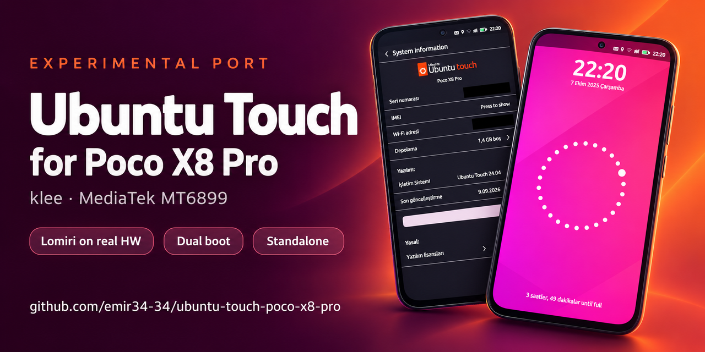
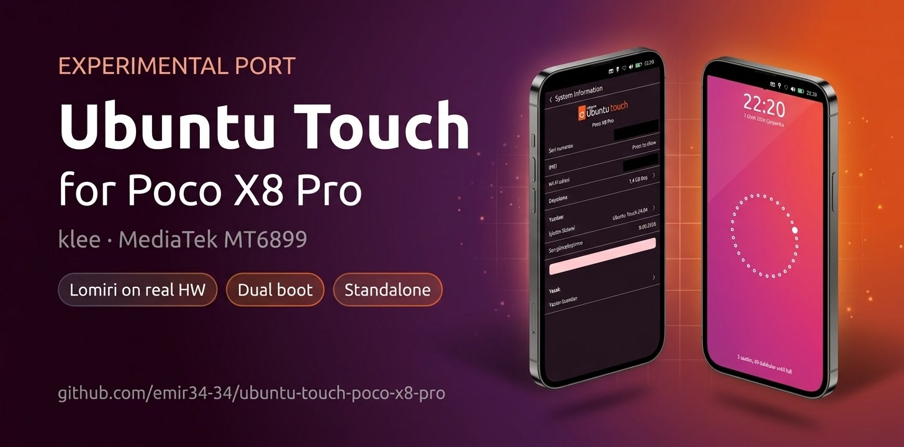
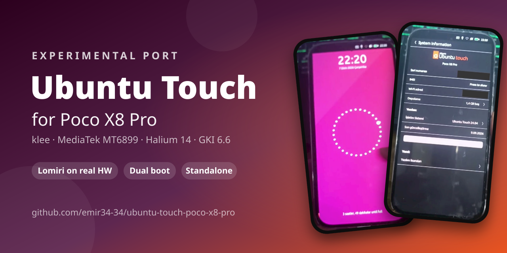

# Ubuntu Touch and ztOS for the Poco X8 Pro (klee, MT6899)

An experimental port of Ubuntu Touch 24.04, with [ztOS](https://github.com/Zerone-Laboratories/ztOS)
on top, for the Xiaomi Poco X8 Pro (codename `klee`, model 2511FRT34C, MediaTek MT6899,
Mali-G720 MC8). The phone runs it every day.

> **Status (2026-10-26): active.** The port was abandoned on 2026-10-08 and picked up again on
> 2026-10-17. Everything since then is in **[CHANGELOG.md](CHANGELOG.md)**, dated to the minute.
> The scripts in this repository are still the ones of the first release (2026-10-09, AxionAOSP
> dual boot). The current install, next to HyperOS, will be published with the move to
> **Arch Linux ARM**, ztOS's own base, which is coming soon.

## How it runs now

- **Dual boot with HyperOS.** HyperOS stays on slot A, untouched. Ubuntu Touch and ztOS boot
  from slot B.
- **No repartitioning.** The `super` partition is full, so Ubuntu Touch's data is a pinned
  (immovable) file in HyperOS's `/data`, the way DSU keeps its images. The initrd maps its
  extents over the raw userdata partition (`klee-pinmap`), after checking the ext4 UUID and a
  trailer at its end.
- **Kernel:** the phone's Android GKI 6.6 with Halium. Ubuntu Touch 24.04 runs the Android
  vendor services in its LXC container.
- **ztOS:** ztMETRO and the ztOS apps run from a chroot, on the Mali GPU through libhybris
  (wlroots 0.20 with a gralloc allocator).
- **Android apps:** Waydroid with LineageOS 23.2 (Android 16), drawing on the same GPU.
- **Flatpak apps:** on the GPU too (libhybris in the sandbox).

## What works

| Feature | Status |
|---|---|
| Boot (slot B, next to HyperOS) | ✅ |
| Display, brightness, 60/120 Hz | ✅ |
| GPU (Mali-G720 through libhybris) | ✅ |
| Touch, keys, vibration | ✅ |
| CPU at full clocks | ✅ (vendor boot caps lifted) |
| Battery and charging | ✅ a full day of daily use |
| Sleep (suspend) | ❔ untested |
| Wi-Fi, Bluetooth (incl. headphones), USB networking | ✅ |
| SIM, mobile data, SMS, calls, microphone | ✅ |
| Loudspeaker, earpiece | ✅ |
| Ambient light sensor, automatic brightness | ✅ |
| Ear detection in calls | 🟡 from the light sensor; the ultrasound proximity sensor is not supported |
| Fingerprint | ✅ (Ubuntu Touch / Lomiri) |
| Rear RGB light (KleeToys app) | ✅ |
| Flashlight | ✅ |
| GPS | ❌ broken for now |
| Cameras | ❌ not in ztOS yet |
| Waydroid (Android 16) | 🟡 GPU, touch and audio work; video playback and camera don't |
| Flatpak apps (Bazaar) | 🟡 run on the GPU; installing apps being tested |

## ⚠️ Read this before you start

1. **IMEI risk.** SELinux is off in Ubuntu Touch. The modem services in the Android container
   rewrite files in `protect_s`/`persist` **without SELinux labels**. Back in Android the modem
   then crashes and the IMEI disappears. There are two layers of protection:
   - `port/overlay/.../klee-selinux-guard` on the Ubuntu Touch side
   - `port/android-side/ksu-module` on the Android side (KernelSU post-fs-data)

   Do not boot Ubuntu Touch without both. The details are in the development notes.
2. **Back up the IMEI/NVRAM partitions.** `release/install.sh` does this: nvram, nvdata, nvcfg,
   protect1/2, md_sec, persist and proinfo.
3. While Android is running, the **active slot's `boot`/`init_boot` partitions are hardware
   write-protected** (UFS DATA PROTECT). Boot images can only be written from fastboot or recovery.
4. The bootloader (LK) is never modified, so **Volume Down + Power** always reaches fastboot.
   If everything breaks, flash Android's `boot`/`init_boot`/`vendor_boot` images back from there.
   Step-by-step recovery for every problem met during development:
   [docs/TROUBLESHOOTING.md](docs/TROUBLESHOOTING.md).

## Repository layout

| Directory | Contents |
|---|---|
| `port/` | The port itself, based on the UBports `halium-gki` template: `build-klee.sh`, `deviceinfo`, `klee.config`, `ramdisk-overlay/` (initramfs patches, slot-aware `sbin/lp-map`), `overlay/` (files and services added to the rootfs), `rootfs-patches/`, `android-side/` (Android/OrangeFox scripts and the KernelSU module), `tools/make-hybrid-vendor-boot-ramdisk.py` |
| `kernel/` | Patch against UBports `kernel-android-common` (`android15-6.6-halium`) (`klee-kernel.patch`), `klee.config`, base commit (`BASE_COMMIT`) |
| `shims/` | glibc↔bionic shims: `klee_free.c` routes bionic memory away from glibc `free()`; GL and window debugging shims |
| `host-tools/` | Host-side checkers: `kmi_check.py`, `abi_check.py`, `add_noop_syms.py`, `crc_check_module.py`, `payload_extract.py` and others |
| `tests/` | `run-standalone-test.sh`: runs the standalone installer and `restore-android.sh` against a fake `adb`/`fastboot` (`tests/mock/`). No phone needed. |
| `qemu-test/` | QEMU integration test with the real kernel, initramfs and rootfs plus Axion's vendor partitions |
| `apps/android-reboot-ubuntu/` | "Switch to Ubuntu" Android app (`build.sh`, no Gradle) |
| `release/` | User scripts: `install.sh`, `boot-ubuntu.sh`, `boot-axion.sh`, `uninstall.sh`, `collect-logs.sh`, plus `README.md` and `TECHNICAL-NOTES.md` |
| `docs/` | **`DEVELOPMENT-NOTES.md`**: everything learned on the device, in rough chronological order. **`TROUBLESHOOTING.md`**: how to get out of a boot loop, lost IMEI and other problems. `screenshots/` |

The built images (`ut_boot.img`, `ut_init_boot.img`, `ubuntu.img`) are **not** included. They
are large and contained the developer's SSH key. Build them from source.

## Building (summary)

You need:
- Linux
- AOSP clang `r510928`, the same compiler as the stock kernel
- `sudo`, for loop mounts
- `lz4`
- `mkbootimg`/`avbtool` (the build script downloads these)
- the Halium 14 rootfs from UBports CI (`halium-gki` → `devel-flashable-android14-6.1`)

```sh
# kernel
git clone -b android15-6.6-halium https://gitlab.com/ubports/porting/community-ports/android12/generic/kernel-android-common.git ~/klee-ut/kernel
cd ~/klee-ut/kernel && git checkout $(cut -d' ' -f1 /path/to/kernel/BASE_COMMIT) && git apply /path/to/kernel/klee-kernel.patch

# port: adjust the path variables at the top of build-klee.sh; the paths must not contain spaces
cp -r port ~/klee-ut/ubports-klee
~/klee-ut/ubports-klee/build-klee.sh          # supports SKIP_KERNEL=1 / SKIP_ROOTFS=1
```

For SSH over USB, put your own public key in `port/overlay/system/etc/klee/authorized_keys`.
Once Ubuntu Touch is up, connect with `ssh -p 8022 root@10.15.19.82` (USB NCM).

Installation (dual boot or standalone) and switching steps: [release/README.md](release/README.md).

## Next steps

- **Arch Linux ARM rewrite** of the whole port, with the install scripts for the HyperOS dual
  boot.
- Waydroid video playback; GPS; cameras in ztOS.

The old notes for the first release (OrangeFox switching, AxionAOSP) are in
[docs/DEVELOPMENT-NOTES.md](docs/DEVELOPMENT-NOTES.md).

## Banners

The banner at the top was made with ChatGPT from the real screenshots. Two alternatives, free to
use for posts about the project:

| `docs/banner2.jpg` (Gemini) | `docs/banner3.png` (hand-made from video frames) |
|---|---|
|  |  |

## Credits

UBports (halium-gki, kernel-android-common), Halium, libhybris, ztOS (Zerone Laboratories), Waydroid,
the OrangeFox klee maintainers and the AxionAOSP klee maintainer.

## License

The klee-specific code, scripts and tools in this repository are shared under GPL-2.0.
- Files taken from UBports `halium-gki` (`port/build/` and the basis of the ramdisk scripts)
  remain under UBports' own terms: halium-gki `e05c1ebd0aab`, build subrepository `78d5df8abeaa`.
- The kernel patch is GPL-2.0.
- The binaries under `port/overlay/.../halium-overlay/system/lib64/` come from AOSP/LLVM
  (Apache-2.0). `libbinder_ndk.so` was patched with `host-tools/add_noop_syms.py`.
